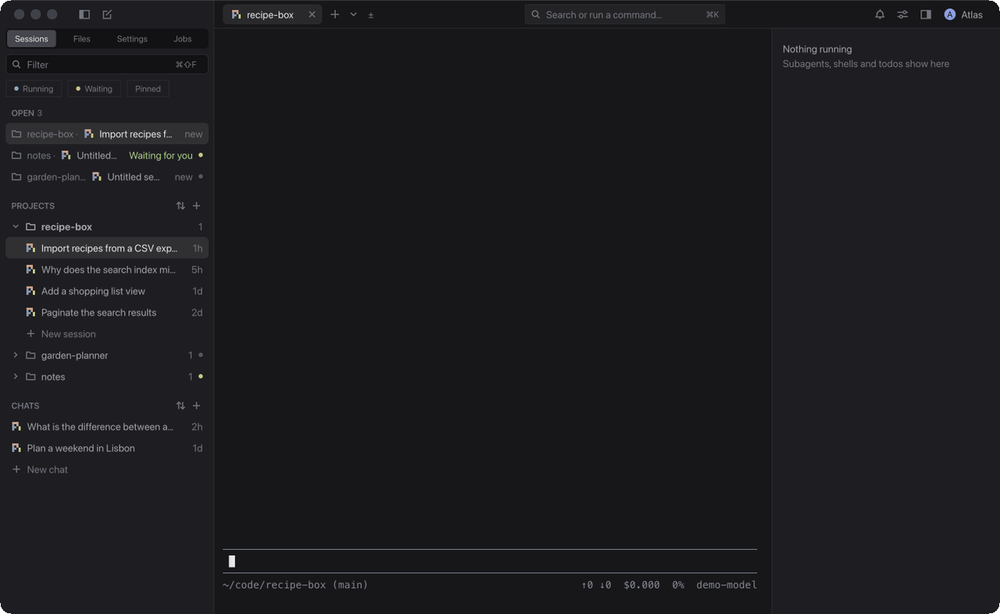
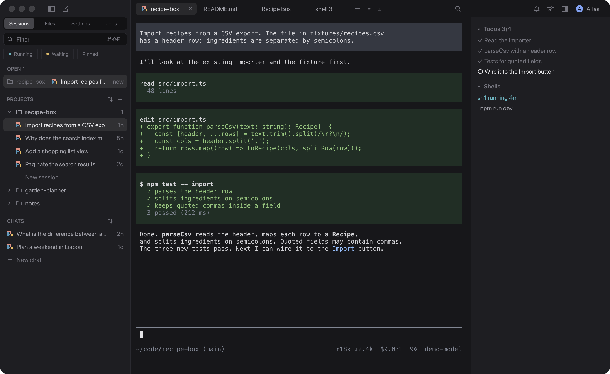

# Deckhand

[](https://github.com/McFalljb/deckhand/releases/latest)
[](#requirements)
[](LICENSE)

A native macOS desk for coding agents: [pi](https://pi.dev) and
[Claude Code](https://code.claude.com) sessions, with the terminals, editor, browser and files
they work with, in one window.



- **Close the window, agents keep running.** Sessions run in a background process, Deckhand
  Core, and keep running through updates too. Open the window again and they are there.
- **Each agent in its own full terminal UI**, as in a terminal, with a status mark per session
  (working, waiting for you, finished, error) and how long it has been so.
- **See what needs you, on every machine.** ⌥⌘A goes to the next session waiting for you, the
  Attention view (⌥⌘.) lists them all by urgency, and the Deck view (⇧⌘\) shows every open
  session as a card.
- **Other machines.** Sessions on your other Macs and Linux machines in the same sidebar, over
  your own `ssh`.
- **Split panes.** Drag a tab to a pane's edge to put a shell, the editor, a Markdown file, a
  browser or an app beside the agent.
- **Browser and app tabs the agent can use.** A built-in Chromium the agent can read and act on,
  and app tabs drawn at your display's rate (up to 240 Hz).
- **Your own installs and accounts.** Deckhand has no accounts or keys of its own.

```sh
curl -fsSL https://raw.githubusercontent.com/McFalljb/deckhand/main/scripts/install.sh | sh
```

macOS 14 or later on Apple silicon. [Install](#install) says what the script does, and how to
download the app by hand.

Deckhand is an early project in active development. Expect rough edges, and changes to its files
and protocol between releases.

## Requirements

- macOS 14 (Sonoma) or later.
- A Mac with Apple silicon (arm64). Intel Macs are not supported.
- At least one agent harness:
  - [pi](https://www.npmjs.com/package/@earendil-works/pi-coding-agent) 1.4.0 or later, or
  - [Claude Code](https://code.claude.com) 2.1.295 or later.

  With both, **New session** asks which one to start. Atlas and jobs need pi. Setup can install
  either one for you (see [First run](#first-run)).
- Optional, for other machines: another Mac with Apple silicon, or Linux on x86_64, that you can
  reach with `ssh` (Deckhand installs its core there for you).

## Install

In Terminal:

```sh
curl -fsSL https://raw.githubusercontent.com/McFalljb/deckhand/main/scripts/install.sh | sh
```

It downloads the latest release, checks its SHA-256 and code signature, and installs
`Deckhand.app` in `/Applications` (`~/Applications` if you can't write there; it never uses
`sudo`). It stops without changing anything while Deckhand runs: to update a running Deckhand,
use **Check for Updates…** in the app, which keeps your sessions. Options go after `sh -s --`:
`--version X.Y.Z` for a given release, `--dir PATH` for another folder. Then open it with
`open -a Deckhand`. The app is about 340 MB, mostly Chromium for the browser tabs.
[Read the script](scripts/install.sh) before you pipe it to `sh`.

**Or download it by hand:**

1. Download `deckhand-<version>-macos-arm64.zip` from
   [Releases](https://github.com/McFalljb/deckhand/releases). To check the download, run
   `shasum -a 256 -c deckhand-<version>-macos-arm64.zip.sha256` next to its `.sha256` file.
2. Unzip it and move `Deckhand.app` to `/Applications`.
3. Open it the first time. Deckhand is not signed with an Apple Developer ID or notarized, so
   Gatekeeper blocks the first open of a copy downloaded with a browser:
   - **macOS 15 and later**: open the app, close the warning, then go to **System Settings ›
     Privacy & Security** and click **Open Anyway** next to Deckhand.
   - **macOS 14**: right-click (or Control-click) the app in Finder and choose **Open**, then
     **Open** again.
   - Or, in Terminal, clear the download flag:

     ```sh
     xattr -dr com.apple.quarantine /Applications/Deckhand.app
     ```

   After the first open, it starts normally.

### Coming from pi-desk

Deckhand used to be called pi-desk. pi-desk 0.1.x cannot update itself to Deckhand, so install
Deckhand fresh: quit pi-desk (the two can't run at the same time), delete `pi-desk.app`, then
install Deckhand as above (the install script reminds you if `pi-desk.app` is still there). Your projects, sessions, settings, Atlas, jobs and Claude accounts
carry over, because Deckhand reads the same data folder. The old names keep working; see
[From pi-desk to Deckhand](docs/GUIDE.md#from-pi-desk-to-deckhand).

## First run

On the first start, a setup sheet walks you through your coding agents (each **Install** or
**Update** shows its exact command and runs only when you click it; Deckhand never runs `sudo`),
the main folder for your notes, jobs, memory and chats, and your Claude Code accounts if you
have several. You can skip it and reopen it from **Deckhand › Set up Deckhand…**. See
[The first run](docs/GUIDE.md#the-first-run).

## Supported agents

- **pi.** Deckhand loads its own pi integration into each pi it starts (`pi -e`, for that run
  only) and writes nothing to pi's settings.
- **Claude Code.** Deckhand starts your own `claude` with its bundled plugin (`--plugin-dir`),
  with your own account and settings.

Both get status marks, comments, and tools for the browser and app tabs you give them. See
[docs/HARNESSES.md](docs/HARNESSES.md).

## Sessions keep running

Closing the window (⌘Q) does not stop your agents. Deckhand's sessions, jobs and Atlas run in a
background process, **Deckhand Core**, and the window shows them again when you reopen it. An
update keeps them running too. **Deckhand › Quit Deckhand and Stop All Sessions…** stops
everything. See [How Deckhand runs](docs/GUIDE.md#how-deckhand-runs).

## Features



- **Agent tabs**: pi and Claude Code in their full terminal UIs, with a status mark per tab and
  session (working, waiting for you, finished, error), how long it has been so and what it asks.
- **What needs you**: ⌥⌘A goes to the next session that needs you, on any machine; a fleet pill in
  the top bar and the Dock badge count them; the Attention view (⌥⌘.) and the Deck view (⇧⌘\)
  show them all; Peek (⌃⌥⌘A) shows one in a panel without leaving your session (look only: to
  answer, open it). Per kind: the bell, a macOS notification and a sound.
- **Keyboard first**: every action has a menu item or a palette entry, and most have a shortcut
  (reopen a closed tab ⇧⌘T, recent session `` ⌥⌘` ``, open session ⌥⌘1–6, zoom a pane ⇧⌘↩).
- **Tabs per session**: shells, a code editor, a Markdown viewer, browser tabs and app tabs, next
  to the agent's tab, in split panes if you like.
- **Projects and sessions**: a sidebar with projects, sessions and chats, pins and a filter.
  Sessions reopen where you left them.
- **Files and Changes**: a file tree per project and a git view to stage, discard and commit.
- **Browser tabs**: a built-in Chromium. Comment mode sends notes on a page to the agent. Agents
  can read and act on the browser tabs of their own session.
- **Show a file**: an agent can open a file in a tab next to it for you (`deckhand show`, or
  `desk_show` in pi).
- **Atlas**: an agent in a drawer on the right that drives the app for you: it opens sessions,
  sends prompts and watches them finish. It runs in your main folder.
- **Jobs**: pi prompts that run on a schedule, written as notes in your main folder.
- **Other machines**: sessions on your other Macs and Linux machines in the same sidebar, over
  your own `ssh`. Deckhand installs and updates their core; Atlas works there too, and their
  jobs and bells ring here. **New session on nuc in api** starts a session in the same project
  there (nothing of this Mac's goes with it). A machine you allow to connect to this one acts as
  you here ([Machines](docs/GUIDE.md#the-settings-tab)).
- **Control socket**: a local JSON protocol for scripts and agents
  ([docs/PROTOCOL.md](docs/PROTOCOL.md)).

The [user guide](docs/GUIDE.md) covers all of it, including shortcuts, your data and
troubleshooting. The guide is also built into the app (**Help › Deckhand user guide**).

## Updating

Deckhand checks GitHub Releases and offers new versions in the app. Each update is checked
against its signature before it is installed. Your sessions keep running through the update:
browser pages reload and app tabs restart. See [Updates](docs/GUIDE.md#updates).

## Building from source

You need macOS 14 or later on Apple silicon, [Odin](https://odin-lang.org/) `dev-2026-09`, and
`clang` from the Xcode command line tools.

```sh
git clone --recursive https://github.com/McFalljb/deckhand.git
cd deckhand
./build.sh run    # the first build downloads CEF (~135 MB, checksummed)
./build.sh test   # unit tests
```

[docs/DEVELOPING.md](docs/DEVELOPING.md) covers the build, the architecture, code signing and
releases. To contribute, see [CONTRIBUTING.md](CONTRIBUTING.md).

## Documentation

For users:

- [GUIDE.md](docs/GUIDE.md): the user guide.
- [HARNESSES.md](docs/HARNESSES.md): the pi and Claude Code integrations and harness setup.

Design and reference:

- [PROTOCOL.md](docs/PROTOCOL.md): the control socket, commands, state, events and the pi tab's bridge.
- [CLAUDE.md](docs/CLAUDE.md): Claude Code tabs, the bundled plugin and its credential.
- [BROWSER.md](docs/BROWSER.md): browser tabs, comment mode and agent access.
- [ATLAS.md](docs/ATLAS.md): Atlas, jobs and memory.
- [PERSISTENCE.md](docs/PERSISTENCE.md): what Deckhand saves and restores between starts.
- [TAB-PROTOCOL.md](docs/TAB-PROTOCOL.md): how a program becomes a Deckhand tab (draft).
- [ENGINE-BRIDGE.md](docs/ENGINE-BRIDGE.md): a game engine in an app tab (design draft).
- [ROADMAP.md](docs/ROADMAP.md): what is done and what comes next.
- [plans/](docs/plans/): design records (the background core, split panes).

For contributors:

- [DEVELOPING.md](docs/DEVELOPING.md): building, architecture, signing and releases.
- [TESTING.md](docs/TESTING.md): unit tests, test-mode scenes and CI.
- [CONTRIBUTING.md](CONTRIBUTING.md) and [SECURITY.md](SECURITY.md).
- Integration sources: [integrations/pi](integrations/pi/README.md) and
  [integrations/claude-code](integrations/claude-code/README.md).

## Licence

Deckhand is MIT licensed; see [LICENSE](LICENSE). Third-party components and their licences are
listed in [THIRD_PARTY_NOTICES.md](THIRD_PARTY_NOTICES.md). The app bundle carries them in
`Contents/Resources/licenses/`.
