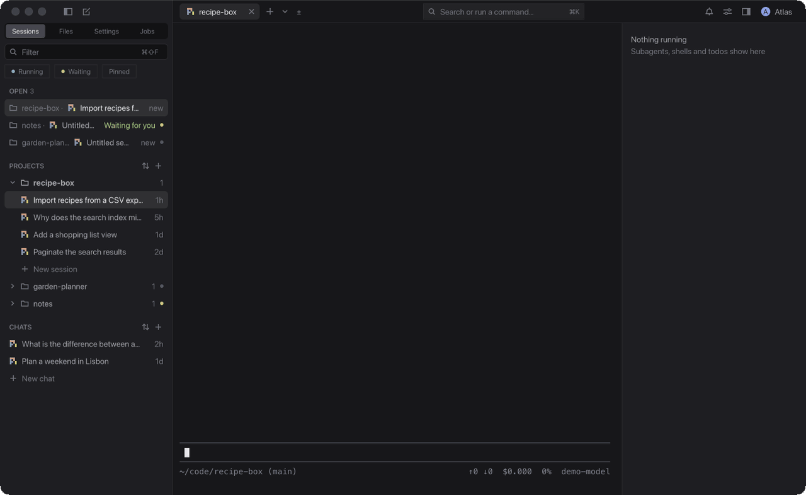
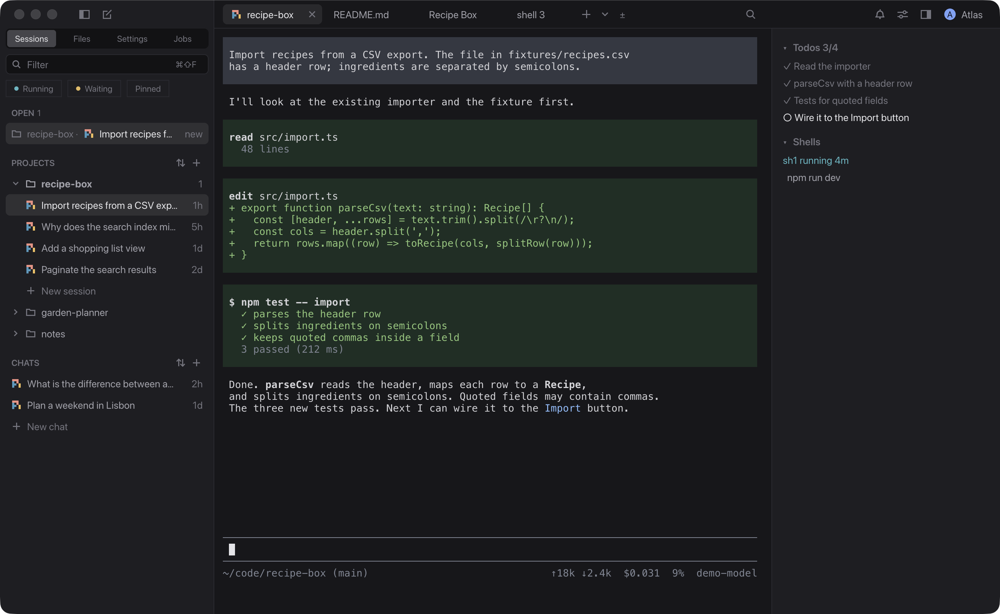

# Deckhand

[](https://github.com/McFalljb/deckhand/releases/latest)
[](#requirements)
[](LICENSE)

A native macOS desk for coding agents. Deckhand runs [pi](https://pi.dev),
[Claude Code](https://code.claude.com) and [Codex](https://github.com/openai/codex) sessions in
their own terminal UIs, with the shells, editor, browser and files they work with, in one window.
Sessions run in a background process, so closing the window or updating the app does not stop
them, and sessions on your other machines show in the same sidebar over `ssh`.



```sh
curl -fsSL https://raw.githubusercontent.com/McFalljb/deckhand/main/scripts/install.sh | sh
```

## Features



**Agents**

- pi, Claude Code and Codex tabs, each in its full terminal UI, with your own installs, accounts
  and settings. Deckhand has no accounts or keys of its own.
- A status mark per tab and session (working, waiting for you, finished, error), how long it has
  been so, and what it asks.
- Several Claude Code and Codex accounts, each tab started under the one you pick.

**What needs you**

- ⌥⌘A goes to the next session waiting for you, on any machine. The Attention view (⌥⌘.) lists
  them by urgency; Peek (⌃⌥⌘A) shows one in a panel without leaving your session.
- The Deck (⇧⌘\\) shows every open session as a card: what it needs, its agent and machine, its
  other tabs.
- The bell, a macOS notification and a sound, set per kind.

**Tabs and panes**

- Shells, a code editor, a Markdown viewer, browser tabs and app tabs beside the agent. Drag a
  tab to a pane's edge to split.
- Browser tabs are a built-in Chromium the session's agent can read and act on.
- App tabs: a program (a game engine, a tool) draws into a tab and the agent can call it.
- An agent can open a file in a tab for you (`deckhand show`, `desk_show` in pi).

**Comments and Changes**

- Point at part of a browser page or app tab and write a note; it goes to the agent with your next
  message, with a cropped picture.
- A file tree per project, and a git view to stage, discard and commit.

**Atlas and jobs**

- Atlas: a pi agent in a drawer that drives Deckhand for you: it opens sessions, sends prompts and
  waits for them to finish.
- Jobs: pi prompts on a schedule, each written as a Markdown note in your main folder.

**Other machines**

- Your other Macs and Linux (x86_64) machines in the same sidebar, over your own `ssh`. Deckhand
  installs and updates its core there; their jobs and alerts ring here.
- **New session on nuc in api** starts a fresh session in the project with the same folder name
  there. **Continue this conversation on nuc** copies a pi conversation from this Mac to the other
  machine and forks it there.

**In a browser**

- A core can serve Deckhand to a browser on a desktop or phone: sessions, terminals, Files and
  Changes. Off by default; pair with a one-time code
  ([Deckhand in a browser](docs/GUIDE.md#deckhand-in-a-browser)).

**Settings and keyboard**

- A Settings page (⌘,) grouped by task, with a search; Quick settings in the gear.
- Every action has a menu item or a palette entry (⌘K); ⌘/ lists every shortcut.
- A local control socket with a JSON protocol for scripts and agents.

## How it works

Deckhand is three programs on each Mac:

- **The window** (`Deckhand.app`): what you see and type into. Browser and app tabs live here.
- **Deckhand Core**: projects, sessions, jobs, Atlas, the bell and the control socket. It runs
  without a window; ⌘Q closes only the window.
- **The session holder**: keeps every tab's terminal, so sessions outlive a restart or update of
  Deckhand Core.

Another machine runs only Deckhand Core and its holder (on Linux as the systemd user service
`deckhand-core`). This Mac reaches it with your own `ssh` and `~/.ssh/config`. The window, the
core and the holder talk only to code signed with Deckhand's certificate, under the same macOS
user. See [How Deckhand runs](docs/GUIDE.md#how-deckhand-runs).

## Install

```sh
curl -fsSL https://raw.githubusercontent.com/McFalljb/deckhand/main/scripts/install.sh | sh
```

The script downloads the latest release, checks its SHA-256 and code signature, and installs
`Deckhand.app` in `/Applications` (or `~/Applications`); it never uses `sudo`, and does nothing
while Deckhand runs (update a running Deckhand with **Check for Updates…**, which keeps your
sessions). [Read it](scripts/install.sh) before you pipe it to `sh`. To install by hand, download
the zip from [Releases](https://github.com/McFalljb/deckhand/releases); the
[guide](docs/GUIDE.md#installing) has the steps, options and the first open past Gatekeeper.

On the first start a setup sheet offers to install or update your coding agents (showing each
command before it runs), and asks for the main folder for notes, jobs and chats.

**Other machines**: add one in Settings › Machines. Deckhand installs its core there over `ssh`
(a Linux machine gets the release's Linux core, checked here first) and updates it from this Mac.
To remove it, see [Removing Deckhand's core from a machine](docs/GUIDE.md#removing-deckhands-core-from-a-machine).

**Updates**: Deckhand checks GitHub Releases about once a day and asks before it updates. Each
update is checked against its signature; sessions keep running through it.

Deckhand used to be called pi-desk; see
[From pi-desk to Deckhand](docs/GUIDE.md#from-pi-desk-to-deckhand).

## Requirements

- macOS 14 or later on Apple silicon. Intel Macs are not supported.
- At least one coding agent: [pi](https://www.npmjs.com/package/@earendil-works/pi-coding-agent)
  1.4.0+, [Claude Code](https://code.claude.com) 2.1.295+ or
  [Codex](https://github.com/openai/codex) 0.163.0+. Atlas and jobs need pi.
- Optional: other machines (Apple silicon Macs, or Linux on x86_64) you can reach with `ssh`.

## Status and limits

Deckhand is an early project in active development. Expect rough edges, and changes to its files
and protocol between releases.

- Releases are self-signed, not signed with an Apple Developer ID or notarized, so macOS blocks
  the first open of a downloaded copy.
- Linux runs Deckhand Core only (for other machines); the window is macOS only.
- Codex tabs were built against a stand-in for Codex, and **Continue this conversation** was
  tested with stand-ins for pi and the link, not yet between two real machines.
- Only pi conversations can be continued on another machine, and only from this Mac
  ([#115](https://github.com/McFalljb/deckhand/issues/115)).
- A machine you allow to connect to this Mac acts as you here
  ([Machines](docs/GUIDE.md#machines)).
- Web access is plain HTTP (encrypt it with Tailscale, a VPN or an HTTPS proxy), shows the view
  in one place at a time, and a paired browser acts as you; not yet tried on a real phone.

## Documentation

| Doc | What it covers |
|---|---|
| [GUIDE.md](docs/GUIDE.md) | The user guide: every feature, shortcut, setting, your data, troubleshooting. Also in the app (**Help › Deckhand user guide**). |
| [HARNESSES.md](docs/HARNESSES.md) | How Deckhand runs pi, Claude Code and Codex, and what setup installs. |
| [CLAUDE.md](docs/CLAUDE.md) | Claude Code tabs, the bundled plugin, accounts. |
| [CODEX.md](docs/CODEX.md) | Codex tabs, the per-run tools, accounts, limits. |
| [BROWSER.md](docs/BROWSER.md) | Browser tabs, comment mode and agent access. |
| [ATLAS.md](docs/ATLAS.md) | Atlas, jobs and memory. |
| [PROTOCOL.md](docs/PROTOCOL.md) | The control socket: commands, state, events, known limits. |
| [PERSISTENCE.md](docs/PERSISTENCE.md) | What Deckhand saves and restores. |
| [TAB-PROTOCOL.md](docs/TAB-PROTOCOL.md) | How a program becomes an app tab (draft). |
| [ENGINE-BRIDGE.md](docs/ENGINE-BRIDGE.md) | A game engine in an app tab (design draft). |
| [ROADMAP.md](docs/ROADMAP.md) | What is done and what comes next. |
| [DEVELOPING.md](docs/DEVELOPING.md) | Building, architecture, signing and releases. |
| [TESTING.md](docs/TESTING.md) | Unit tests, test-mode scenes and CI. |
| [plans/](docs/plans/) | Design records: the background core, split panes. |

Integration sources: [integrations/pi](integrations/pi/README.md),
[integrations/claude-code](integrations/claude-code/README.md).

## Building and contributing

You need macOS 14+ on Apple silicon, [Odin](https://odin-lang.org/) `dev-2026-09` and `clang`
from the Xcode command line tools.

```sh
git clone --recursive https://github.com/McFalljb/deckhand.git
cd deckhand
./build.sh run    # the first build downloads CEF (~135 MB, checksummed)
./build.sh test   # unit tests
```

See [CONTRIBUTING.md](CONTRIBUTING.md), and [SECURITY.md](SECURITY.md) to report a vulnerability.

## Licence

MIT; see [LICENSE](LICENSE). Third-party components and their licences are in
[THIRD_PARTY_NOTICES.md](THIRD_PARTY_NOTICES.md), and in the app at
`Contents/Resources/licenses/`.
