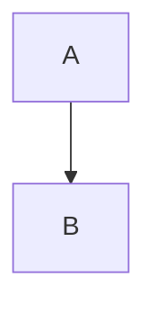

# Heading one

Heading two
-----------

### Emphasis *in* a `heading` ###

## Heading one

## Ünïcödé — punctuation: (ok)? & *more*

####### seven hashes is text

#no space is text

A paragraph with a soft
break and a hard  
break and a backslash\
break.

Setext over
two lines
=========

***
---
___
 - - -

> A quote
lazy continuation
>
> > nested quote
> > - with a list
> > - two
>
> ```
> code in a quote
> ```

- tight one
- tight two
  - nested tight
  - nested two
    1. deep ordered
    2. deep two
- tight three

+ plus list

* star list

3. starts at three
4. four

1) paren delimiter
2) two

- loose one

- loose two

  second paragraph in loose two

-
- empty item above
- ```
  code first in an item
  ```
- > quote in an item
- # heading in an item
- ---

- [ ] open task
- [x] done task
- [X] upper done task
- [ ]
- [x]no space after
- not a task [ ] here
  - [ ] nested task
1. [x] ordered task

- [ ] loose task

  with a second paragraph

```go
func main() {
	println("hi")
}
```

~~~ python extra words
print("tilde")
~~~

````md
```
nested fence
```
````

```
```



    indented code
    	with a tab

      more indented

Paragraph then

    not code (lazy)

<div>
an <b>html</b> block &amp; entity
</div>

<!-- a comment
over lines -->

<script>
alert("not run")
</script>

<p>a p tag</p> trailing

| Left | Center | Right | None |
|:-----|:------:|------:|------|
| a | **b** | `c` | [d](#heading-one) |
| e \| pipe | f |
| g | h | i | j | k extra |

no | leading | pipe
---|---|---
1 | 2 | 3

| a |
|---|
paragraph line after the table

- | table | in list |
  |-------|---------|
  | x     | y       |

| not | a table |
| --- |
| x | y |

[ref]: /reference-url "Ref Title"

---

[Case Ref]: <with spaces.md> 'single'

Final paragraph with [ref] and [case ref][] and [full][ref].

Unclosed fence follows

```js
let x = 1
